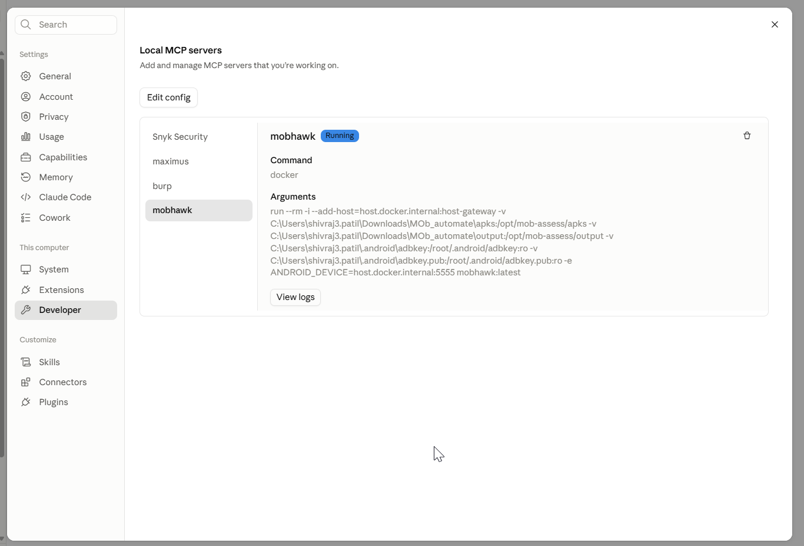
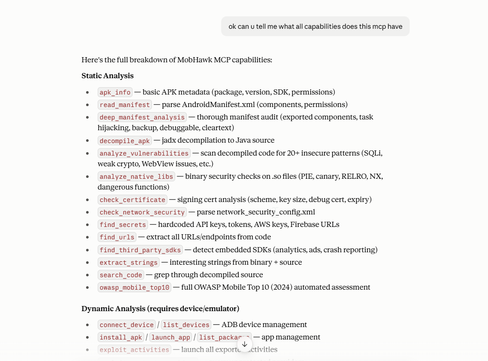
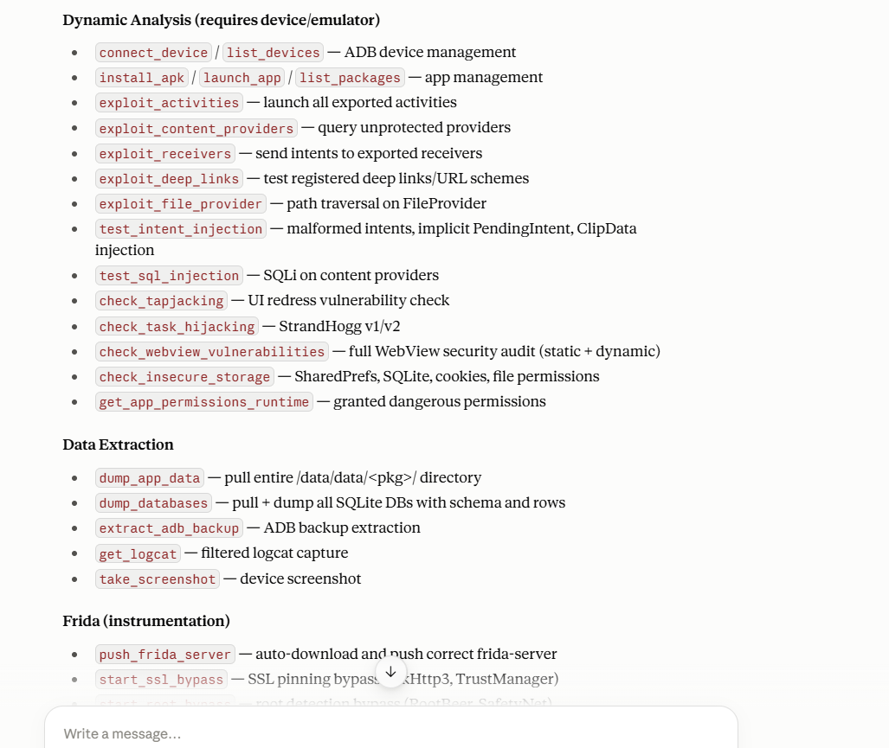
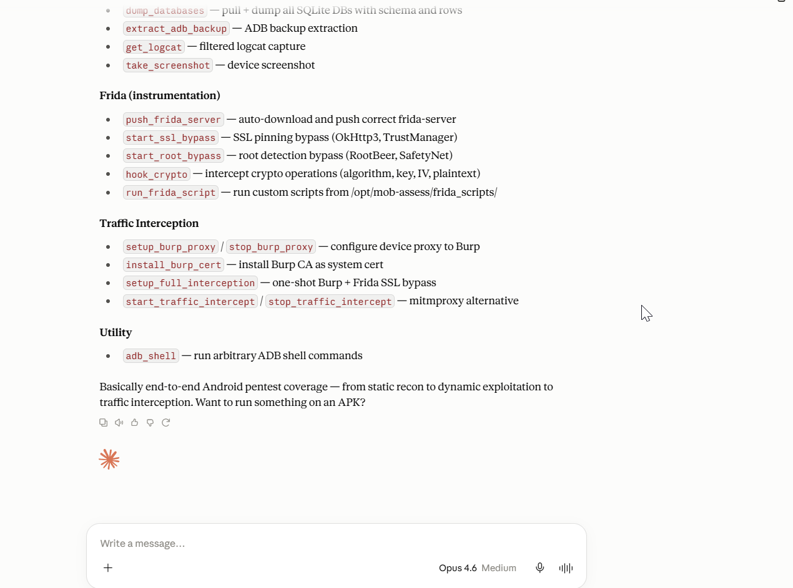
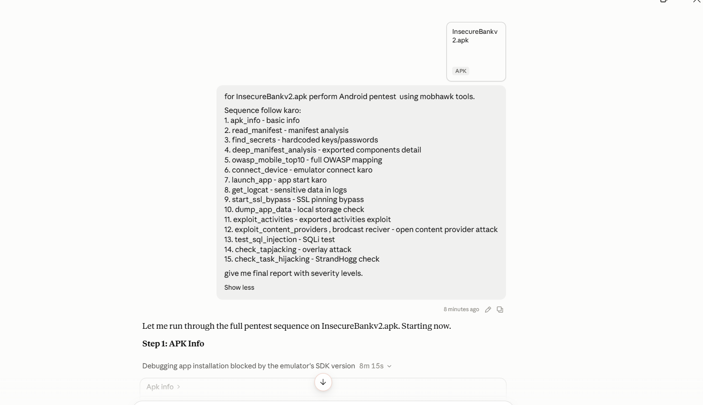
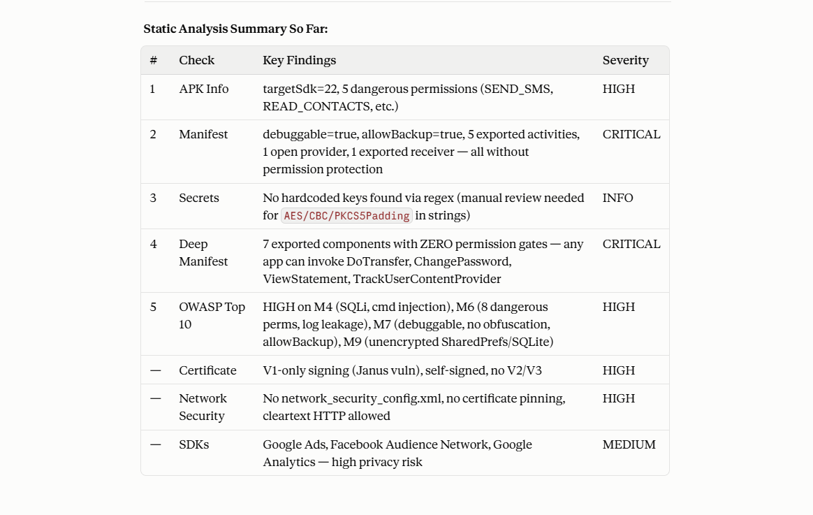
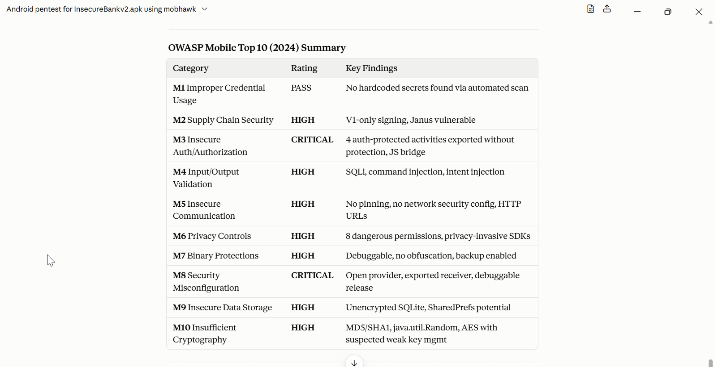
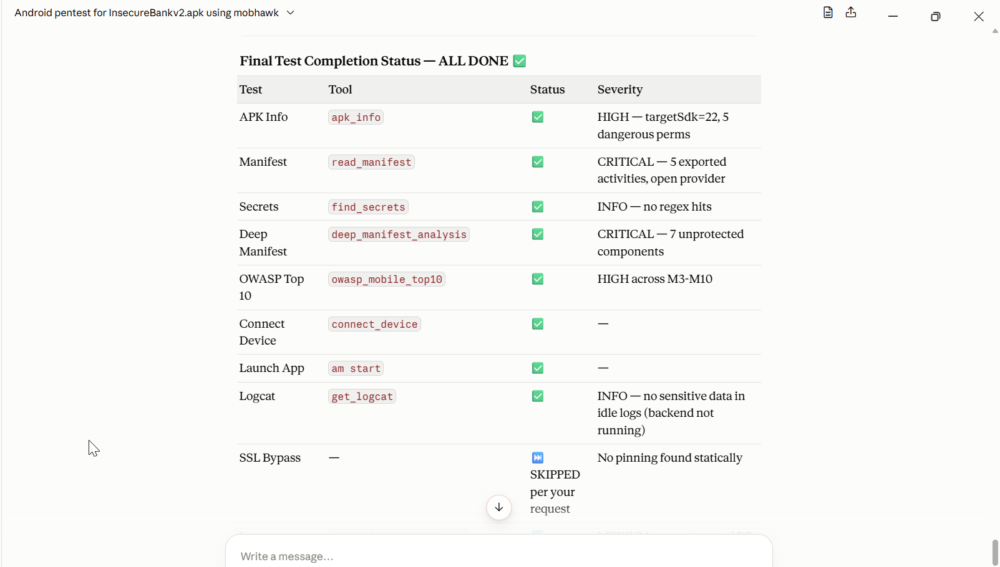
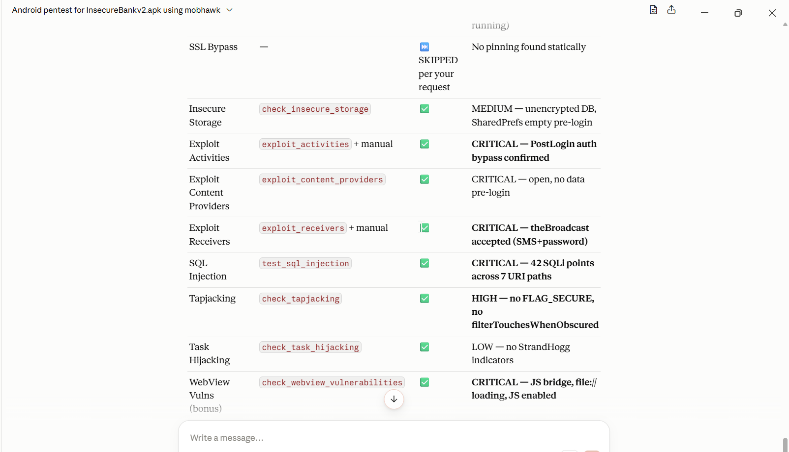
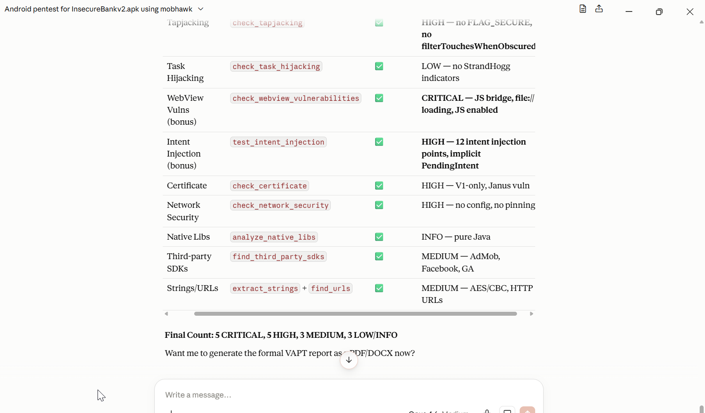

<p align="center">
  
  
  
  
  
  
</p>

# MobHawk

**AI-Powered Android Application Security Assessment Platform**

MobHawk is an automated Android penetration testing framework that integrates with **Claude Desktop** via the **Model Context Protocol (MCP)**. It exposes **40+ pentest tools** through natural language — just describe what you want to test, and Claude orchestrates the entire assessment pipeline: static analysis, dynamic testing, exploit verification, Frida-based runtime instrumentation, and traffic interception.

> Talk to Claude. Pentest Android apps. Get a full VAPT report.

---

## Architecture

```
+--------------------+         MCP (stdio)         +--------------------+
|                    | <=========================> |                    |
|   Claude Desktop   |    Natural Language Input    |   MobHawk Server   |
|   (AI Interface)   |    Structured Tool Calls     |   (40+ Tools)      |
|                    | <=========================> |                    |
+--------------------+                              +--------+-----------+
                                                             |
                                    +------------------------+------------------------+
                                    |                        |                        |
                             +------+------+          +------+------+          +------+------+
                             |   Static    |          |   Dynamic   |          |   Exploit   |
                             |  Analysis   |          |  Analysis   |          |   Testing   |
                             +------+------+          +------+------+          +------+------+
                                    |                        |                        |
                              jadx, apktool            ADB, Frida              Intent fuzzing
                              androguard               mitmproxy               SQLi, XSS
                              regex engine             logcat                  Deep links
                                                       Burp Suite              WebView attacks
                                                             |
                                                    +--------+--------+
                                                    |  Android Device  |
                                                    |  / Emulator      |
                                                    +-----------------+
```

---

## Features

### Static Analysis (No Device Required)

| Tool | Description |
|------|-------------|
| `apk_info` | APK metadata — package name, version, SDK targets, permissions |
| `read_manifest` | AndroidManifest.xml parser — components, permissions, intent filters |
| `deep_manifest_analysis` | Exported components, task hijacking, backup config, cleartext traffic |
| `decompile_apk` | jadx decompilation to Java source (apktool fallback, React Native/Expo aware) |
| `analyze_vulnerabilities` | 20+ vulnerability patterns — SQLi, weak crypto, WebView issues, TrustAll SSL |
| `analyze_native_libs` | Binary security checks on `.so` files — PIE, canary, RELRO, NX, dangerous functions |
| `check_certificate` | Signing scheme analysis (V1/V2/V3), key size, debug cert detection |
| `check_network_security` | Network Security Config XML parsing |
| `find_secrets` | Hardcoded API keys, AWS keys, JWT tokens, Firebase URLs, private keys |
| `find_urls` | URL and IP extraction with categorization |
| `find_third_party_sdks` | 40+ SDK definitions with privacy implications |
| `extract_strings` | Binary + source string extraction with categorization |
| `search_code` | Grep through decompiled source |
| `owasp_mobile_top10` | Full OWASP Mobile Top 10 (2024) automated assessment |

### Dynamic Analysis (Requires Device/Emulator)

| Tool | Description |
|------|-------------|
| `connect_device` / `list_devices` | ADB device management |
| `install_apk` / `launch_app` / `list_packages` | App lifecycle management |
| `get_logcat` | Filtered logcat capture for sensitive data leaks |
| `take_screenshot` | Device screenshot capture |
| `dump_app_data` | Pull entire `/data/data/<pkg>/` — flags sensitive data in DBs, prefs, files |
| `dump_databases` | Full SQLite dump with schema and row preview |
| `check_insecure_storage` | SharedPrefs, SQLite, WebView cookies, external storage, file permissions |
| `get_app_permissions_runtime` | Runtime dangerous permission status |
| `adb_shell` | Run arbitrary ADB shell commands |

### Exploit Testing

| Tool | Description |
|------|-------------|
| `exploit_activities` | Launch all exported activities — auth bypass detection |
| `exploit_content_providers` | Query unprotected content providers |
| `exploit_receivers` | Send intents to exported broadcast receivers |
| `exploit_deep_links` | Test URL schemes with injection payloads |
| `exploit_file_provider` | Path traversal testing against FileProviders |
| `test_sql_injection` | 10 SQLi payloads against content providers |
| `test_intent_injection` | Malformed intents, PendingIntent hijacking, ClipData injection |
| `check_tapjacking` | UI redress / overlay attack detection |
| `check_task_hijacking` | StrandHogg v1/v2 detection |
| `check_webview_vulnerabilities` | 15 static checks + dynamic JS injection and `file://` scheme tests |
| `extract_adb_backup` | ADB backup extraction with sensitive data search |

### Frida Instrumentation

| Tool | Description |
|------|-------------|
| `push_frida_server` | Auto-detect arch, download, and push frida-server to device |
| `start_ssl_bypass` | SSL pinning bypass — 11 hooks including OkHttp3, TrustManager, Flutter/libssl |
| `start_root_bypass` | Root detection bypass — 10 hooks including RootBeer, SafetyNet |
| `hook_crypto` | Crypto monitoring — 9 hooks capturing algorithm, key, IV, plaintext/ciphertext |
| `run_frida_script` | Execute custom Frida scripts |

### Traffic Interception

| Tool | Description |
|------|-------------|
| `setup_burp_proxy` / `stop_burp_proxy` | Configure device proxy to Burp Suite |
| `install_burp_cert` | Install Burp CA as system certificate |
| `setup_full_interception` | One-shot Burp + Frida SSL bypass |
| `start_traffic_intercept` / `stop_traffic_intercept` | mitmproxy alternative |

---

## Proof of Concept

### MCP Server Running in Claude Desktop

The MobHawk MCP server integrates directly into Claude Desktop as a local MCP server, running inside a Docker container.

<p align="center">
  
</p>

### 40+ Security Tools via Natural Language

Ask Claude about MobHawk's capabilities and it lists all available tools across static analysis, dynamic testing, exploit verification, Frida instrumentation, and traffic interception.

<p align="center">
  
</p>

<p align="center">
  
</p>

<p align="center">
  
</p>

### Full Pentest Run on InsecureBankv2.apk

A complete 15-step pentest sequence executed through natural language — from APK info to SQL injection testing — all orchestrated by Claude using MobHawk tools.

<p align="center">
  
</p>

### Static Analysis Summary

Automated static analysis results with severity classification across APK metadata, manifest analysis, secrets scanning, deep manifest audit, OWASP Top 10 mapping, certificate validation, network security, and third-party SDK detection.

<p align="center">
  
</p>

### OWASP Mobile Top 10 (2024) Assessment

Automated mapping against all 10 OWASP Mobile categories with severity ratings and key findings for each category.

<p align="center">
  
</p>

### Complete Test Results Dashboard

Full test completion status with all tools executed, their results, and severity classifications — **5 CRITICAL, 5 HIGH, 3 MEDIUM, 3 LOW/INFO** findings across 20+ test categories.

<p align="center">
  
</p>

<p align="center">
  
</p>

<p align="center">
  
</p>

---

## Prerequisites

| Requirement | Version |
|------------|---------|
| Docker Desktop | Latest |
| Claude Desktop | Latest |
| Windows 10/11 | (for batch scripts) |
| Android Studio | (optional, for host emulator) |

---

## Quick Start

### 1. Clone and Setup

```bash
git clone https://github.com/<your-username>/MobHawk.git
cd MobHawk
setup.bat
```

The setup script builds Docker images, creates required directories, and starts the web dashboard.

### 2. Configure Claude Desktop

Add the MobHawk MCP server to your Claude Desktop config (`%APPDATA%\Claude\claude_desktop_config.json`):

**Option A: Docker Emulator (Self-Contained)**
```json
{
  "mcpServers": {
    "mobhawk": {
      "command": "docker",
      "args": [
        "compose", "-f", "C:/path/to/MOb_automate/docker-compose.yml",
        "--profile", "full", "run", "--rm", "-T", "mob-assess"
      ]
    }
  }
}
```

**Option B: Host Emulator (Fastest)**
```json
{
  "mcpServers": {
    "mobhawk": {
      "command": "docker",
      "args": [
        "run", "--rm", "-i", "--add-host=host.docker.internal:host-gateway",
        "-v", "C:/path/to/MOb_automate/apks:/opt/mob-assess/apks",
        "-v", "C:/path/to/MOb_automate/output:/opt/mob-assess/output",
        "-e", "ANDROID_DEVICE=host.docker.internal:5555",
        "mobhawk:latest"
      ]
    }
  }
}
```

### 3. Start an Emulator

```bash
# Option A: Docker-based emulator
start-android.bat

# Option B: Rootable AVD with Frida (recommended)
setup-rootable-avd.bat    # one-time setup
start-rootable-emulator.bat

# Option C: Android Studio emulator
start-host-emulator.bat
```

### 4. Drop an APK and Go

Place your target APK in the `apks/` folder, open Claude Desktop, and start testing:

```
Perform a full security assessment of InsecureBankv2.apk using mobhawk tools
```

---

## Usage Examples

### Quick Static Scan
```
Analyze the APK info and check the manifest of myapp.apk for security issues
```

### Full OWASP Assessment
```
Run owasp_mobile_top10 on myapp.apk and give me findings with severity levels
```

### Dynamic Exploit Testing
```
Connect to the emulator, install myapp.apk, then exploit all exported activities
and test for SQL injection on content providers
```

### Frida SSL Bypass + Traffic Capture
```
Start SSL pinning bypass on com.example.app, then setup full Burp interception
```

### Automated Full Pentest (No Claude Required)
```bash
run-full-pentest.bat myapp.apk
```
Runs 9 tools sequentially: `apk_info` -> `check_certificate` -> `analyze_vulnerabilities` -> `extract_strings` -> `exploit_activities` -> `exploit_deep_links` -> `exploit_receivers` -> `exploit_content_providers` -> `test_sql_injection`

---

## Web Dashboard

A dark-themed Flask dashboard for APK management and report viewing.

```bash
# Starts on http://localhost:5000
docker compose --profile web up -d
```

**Features:**
- Drag-and-drop APK upload (up to 500MB)
- APK file management with one-click path copy
- Scan results viewer with severity summary (CRITICAL / HIGH / MEDIUM / LOW / INFO)
- Findings table with exploitability badges
- Auto-refresh every 30 seconds

---

## Project Structure

```
MobHawk/
├── mcp_server/
│   ├── server.py                 # MCP server entry point (40+ tool definitions)
│   ├── tools/
│   │   ├── static.py             # Static analysis (14 tools, 2277 lines)
│   │   ├── dynamic.py            # Dynamic analysis (19 tools, 1852 lines)
│   │   └── exploit.py            # Exploit testing (11 tools, 1847 lines)
│   └── requirements.txt
├── frida_scripts/
│   ├── ssl_bypass.js             # 11 SSL/TLS hooks (incl. Flutter)
│   ├── root_bypass.js            # 10 root detection hooks (incl. RootBeer, SafetyNet)
│   └── crypto_hook.js            # 9 crypto class hooks
├── web/
│   ├── app.py                    # Flask web dashboard
│   └── templates/index.html      # Dark-themed UI
├── android/
│   └── start-emulator.sh         # Docker emulator startup
├── apks/                         # Drop target APKs here
├── output/                       # Generated reports and decompiled output
├── POC/                          # Proof of concept screenshots and reports
├── Dockerfile                    # Pentest tools image (Ubuntu 22.04, JDK 17)
├── Dockerfile.android            # Android emulator image (API 28, rooted)
├── docker-compose.yml            # 3 services: android, mob-assess, mob-assess-web
├── setup.bat                     # One-click setup
├── run-full-pentest.bat          # Automated 9-tool pentest
├── start-android.bat             # Start Docker emulator
├── start-host-emulator.bat       # Start Android Studio emulator
├── setup-rootable-avd.bat        # One-time rootable AVD setup
├── start-rootable-emulator.bat   # Start rootable emulator with Frida
└── claude_desktop_config.json    # MCP config templates
```

---

## Tech Stack

| Component | Technology |
|-----------|-----------|
| AI Interface | Claude Desktop + MCP Protocol |
| Language | Python 3.11 |
| Containerization | Docker + Docker Compose |
| Static Analysis | jadx 1.5.0, apktool 2.9.3, androguard, dex2jar |
| Dynamic Analysis | ADB, Frida 12.5.0, Objection 1.11.0 |
| Traffic Interception | mitmproxy 10.3.1, Burp Suite |
| Web Dashboard | Flask 3.0.3 |
| Runtime Hooking | Frida (custom JS scripts) |
| Emulator | Android API 28/34 (x86/x86_64) |

---

## Disclaimer

This tool is intended for **authorized security testing**, **penetration testing engagements**, and **educational purposes** only. Always obtain proper authorization before testing any application. Unauthorized access to computer systems is illegal. The authors are not responsible for any misuse of this tool.

---

## License

MIT

---

<p align="center">
  <b>MobHawk</b> — From APK to VAPT Report, Powered by AI
</p>
